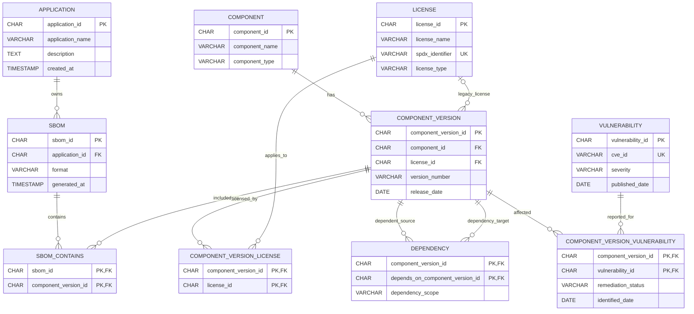

# Relational ER diagram

The diagram reflects the tables and keys in
[`database/mysql/schema.sql`](../../database/mysql/schema.sql). MySQL is the
source of truth for these entities; Neo4j stores a synchronized dependency
graph and does not replace these relations.

`COMPONENT_VERSION_LICENSE` is the many-to-many license association used by
imports. `COMPONENT_VERSION.license_id` remains for compatibility; readers
union both sources and de-duplicate them. `DEPENDENCY` is global per component
version pair, not attached to an SBOM. Its direction is from
`component_version_id` (dependent) to `depends_on_component_version_id`
(dependency).

The schema declares primary and unique keys and foreign-key constraints,
including `CHECK` constraints for severity, remediation status, and
self-dependencies. InnoDB provides supporting indexes for key and foreign-key
operations; the schema does not declare separate workload-specific secondary
indexes.
